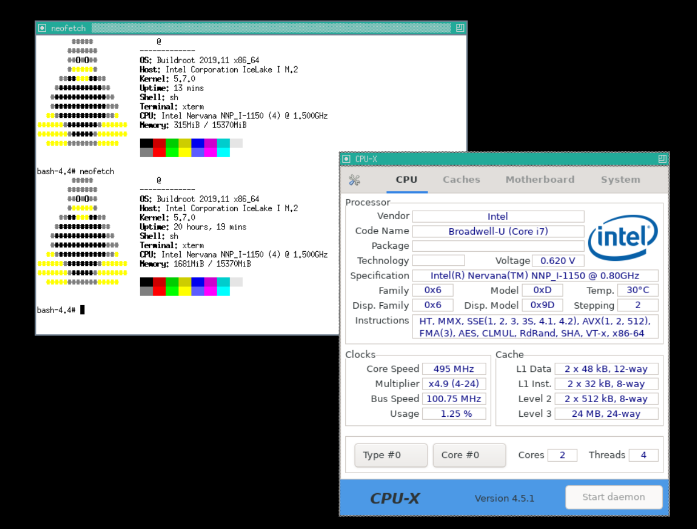

# 卡端 Linux 运行时

卡上 x86 SoC 运行 Buildroot Linux，rootfs 为 RAM initramfs。本页记录
运行时组成、图形环境与持久化方式。

## 1. 系统组成

| 项目 | 值 |
| --- | --- |
| 内核 | Linux 5.7.0 x86_64 |
| 发行版 | Buildroot 2019.11 |
| rootfs | initramfs（内存盘） |
| 初始化 | BusyBox init |
| 显示 | Xvfb + twm + xterm |
| 监控 | CPU-X 4.5.1 |
| 远程 | x11vnc（RFB 003.008） |

由于 rootfs 在内存中，修改默认在重启后丢失。需要跨重启保留的内容可以写进
镜像，或走 [TCP NBD 存储](storage-tcp-nbd.md)：主机的 VHDX 挂在 `/mnt/vhdx`，
写回服务定时把 RAM 根同步进去。

## 2. 图形环境

卡端没有物理显示输出，使用 Xvfb 提供虚拟帧缓冲：

```sh
Xvfb :0 -ac -screen 0 1024x768x24 &
```

`-ac` 必须保留。没有它时 X 的访问控制会阻塞连接，表现为客户端挂起而不是
明确报错。

启动顺序：

```sh
Xvfb :0 -ac -screen 0 1024x768x24 &
sleep 1
x11vnc -display :0 -forever -shared &
twm -display :0 &
xterm -display :0 &
cpu-x --display :0 &
```

x11vnc 应先于窗口管理器启动。顺序反过来时，x11vnc 会卡在 `poll`，VNC
端口可连接但握手无响应。x11vnc 不要加 `-v`，详细日志会触发内核 socket
忙循环，导致 RFB 握手卡死。

## 3. 持久化项

需要在镜像中固化、否则重启即丢失的内容：

- GLib schema 编译产物（`gschemas.compiled`），否则 GTK 应用启动报错；
- DejaVu 字体（Sans 与 Mono 全套），否则 CPU-X 界面缺字；
- Xvfb 启动参数中的 `-ac`；
- x11vnc 与窗口管理器的启动顺序。

初始化脚本中若先启动 twm/xterm 再启动 x11vnc，会出现第 2 节的挂起。
修正需要重新构建 initramfs。

## 4. 构建环境

镜像在 WSL 中交叉构建。构建目录通常是一块独立的 ext4 虚拟盘，避免与
Windows 文件系统的大小写和权限差异。构建要点：

- Buildroot 输出目录与 `dl/` 缓存分离；
- 内核使用厂商提供的 5.7 树，不修改其配置；
- 额外软件包（CPU-X、x11vnc、字体、schema）通过 Buildroot 配方加入；
- 生成的 initramfs 与内核打包为可引导镜像，由主机驱动通过 DMA 加载。

镜像与主机驱动存在版本对应关系：镜像布局或校验值变化后，驱动侧的镜像
描述与工具白名单需要同步更新，否则加载会被拒绝。

## 5. 运行限制

- CPU 频率固定在约 500 MHz，由硬件信号限制，软件无法提升；
- 内存与 `/tmp` 空间有限，部署大型运行时前需确认剩余空间；
- 无包管理器与网络安装源，软件必须以离线包形式提供；
- 重启后所有运行时修改消失，需要重新部署。

## 6. 实际运行画面

下面这张截图来自卡端的 Xvfb 桌面，左边是两次 neofetch，右边是 CPU-X 4.5.1：



两次 neofetch 是两次不同的启动：一次 uptime 13 分钟、内存占用 315 MiB，
另一次 uptime 20 小时 19 分钟、占用 1681 MiB。两次都显示 4 个线程、
15,370 MiB 总内存，CPU 型号字符串是 `Intel Nervana NNP-I-1150 (4)
@ 1.500GHz`。

频率有三组数字，含义不同：

- neofetch 的 `1.500GHz` 来自型号字符串，不是实时频率；
- CPU-X 的 `Specification` 里是 `@ 0.80GHz`，来自 CPUID 的品牌串；
- CPU-X 显示的 `Core Speed` 是 495 MHz，倍频 x4.9，总线 100.75 MHz。

最后这一组是运行时读数，和前面说的约 500 MHz 限制一致。前两个是字符串
里的标称值，不能当实时频率用。

CPU-X 的缓存和指令集信息：L1D 2 x 48 KiB、12 路；L1I 2 x 32 KiB、8 路；
L2 2 x 512 KiB、8 路；L3 24 MiB、24 路。指令集包含 AVX-512、AVX2、FMA3、
AES、SHA、VT-x 等。界面里 `Code Name` 显示 `Broadwell-U (Core i7)`，
和 DMI 里的 `IceLake I M.2` 对不上。识别卡型时以 DMI 信息和 CPUID 原始
型号为准，不要用这一行。

截图中还能看到 Xvfb + twm + xterm 的实际效果。卡端没有物理显示输出，
这些窗口是通过 x11vnc 看到的。
